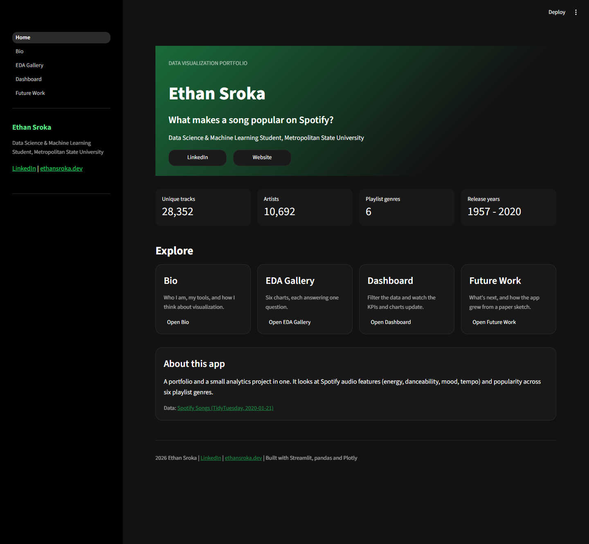
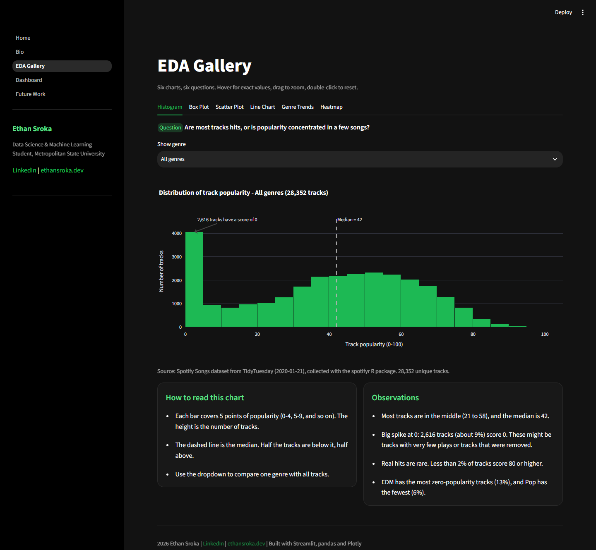
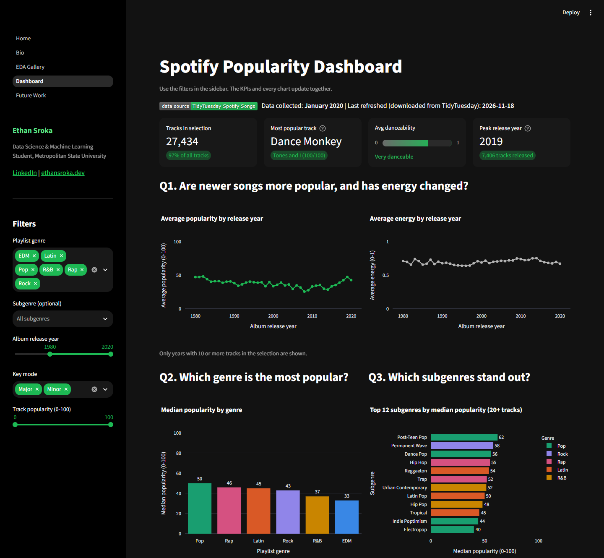

# Spotify Song Popularity - Streamlit Data Visualization Portfolio

A multi-page Streamlit app that is both my professional portfolio and a small analytics project.
It explores what makes songs popular on Spotify by looking at audio features (energy, danceability,
valence, tempo) and popularity across six playlist genres, using an EDA gallery and an interactive dashboard.

**Live app:** _add Streamlit Cloud URL here_
**Repository:** https://github.com/ethancs13/Project-2-streamlit

## Author

**Ethan Sroka** - Data Science & Machine Learning student, Metropolitan State University
- LinkedIn: https://www.linkedin.com/in/ethan-sroka-8402631a2/
- Website: https://ethansroka.dev

## App Navigation

| Page | What it shows |
|------|---------------|
| **Home** (`Home.py`) | Title, purpose of the app, quick dataset facts, and links to each page |
| **Bio** | Professional summary, highlights, profile photo, and my visualization philosophy |
| **EDA Gallery** | Six tabs: histogram, box plot, scatter plot, line chart, genre trends (line + bar), and heatmap. Each has a question, a "How to read this chart" guide, and observations |
| **Dashboard** | Sidebar filters (genre, subgenre, release year, key mode, popularity), 4 KPIs (tracks, most popular track, danceability, peak year), and 5 linked charts that all update together, plus insights |
| **Future Work** | Five next steps and a reflection on how the app changed from my Lab 4.3 paper prototype |

## Dataset

- **Name:** Spotify Songs (TidyTuesday, week of 2020-01-21)
- **Source:** https://github.com/rfordatascience/tidytuesday/tree/master/data/2020/2020-01-21
- **Original source:** Collected from the Spotify Web API by Kaylin Pavlik using the `spotifyr` R package
- **Records:** 32,833 rows in the raw file and 28,352 unique tracks after cleaning (23 columns)
- **File:** `data/spotify_songs.csv` (included in the repo, so no download is needed)

### Preprocessing (in `utils/data.py`)
1. Removed 5 rows with a missing track name and artist.
2. Removed duplicate `track_id`s (the same song can appear in several playlists) and kept the first one, so each song is only counted once. A song keeps the genre of the first playlist it appeared in.
3. Created `release_year` from the first 4 characters of the album release date (some dates are year-only).
4. Added helper columns: `duration_min`, a readable `genre` label, a title-case `subgenre`, and `key_mode` (Major/Minor).

No values were imputed.

### Ethics Note
This dataset describes songs, but the music and its popularity come from real artists and listeners, so results should be interpreted carefully. Because the tracks come from Spotify playlists chosen by a single collector, they may reflect curation bias (mostly recent, English and Spanish-language music) and do not represent all music or all listeners. Popularity is a single snapshot of Spotify's internal score from January 2020. The visualizations show patterns, but they should not be used to judge individual artists or to make broad claims about music overall.

## Requirements

All packages and exact versions are listed in [`requirements.txt`](requirements.txt):
`streamlit`, `pandas`, `plotly`, `numpy`. Python 3.11 or newer is required (pandas 3).

### Run locally
```bash
pip install -r requirements.txt
streamlit run Home.py
```

## Project Structure
```
Home.py                 Home page (main file)
pages/                  Bio, EDA Gallery, Dashboard, Future Work
utils/data.py           Loads and cleans the data (cached with st.cache_data)
utils/ui.py             Shared colors, sidebar, and helper functions
data/spotify_songs.csv  Dataset
assets/                 Profile photo and screenshots
.streamlit/config.toml  Theme
part1/                  Part 1 write-up (5E Data Questioning Cycle)
```

## Accessibility
- Colorblind-safe color palette (checked with a color vision deficiency validator), and each genre keeps the same color on every chart.
- Genre names are on the axes or in the legend, so color is never the only way to identify a genre. Several charts also have a data table view.
- Every chart has a descriptive title, labeled axes, and units. Bar charts start at zero.

## Screenshots

<table>
  <tr>
    <th>Home</th>
    <th>EDA Gallery</th>
    <th>Dashboard</th>
  </tr>
  <tr>
    <td valign="top" width="33%"><a href="assets/screenshots/home.png"></a></td>
    <td valign="top" width="33%"><a href="assets/screenshots/eda_gallery.png"></a></td>
    <td valign="top" width="33%"><a href="assets/screenshots/dashboard.png"></a></td>
  </tr>
</table>

_Click a screenshot to see it full size._

## AI Assistance
I used Claude (Anthropic) to help write code, draft text, and generate questions for Part 1. I reviewed and edited everything.
